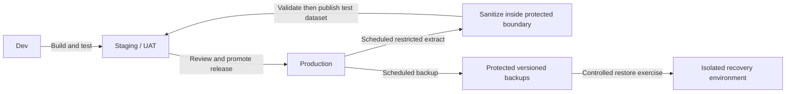

# The wheel of misfortune

A take-home exercise for startups with 1–5 people. This is a proposed learning and release practice, not an instruction to disrupt production. Start with a manually triggered monthly drill; it does not require a chaos-engineering platform.

> **Break it in UAT. Recover it. Keep the receipt.**

## Build, rehearse, serve

Dev is for building; staging is a rehearsal of the deployment; UAT means user acceptance testing and can use the staging environment. Production serves customers. Use separate databases, storage, credentials, and integration configurations. Labels alone do not prevent a staging process from changing production. An ephemeral staging environment is acceptable if it can exercise the relevant behavior.

Staging uses test payment credentials and captured email/webhooks. It must not send messages to real customers or reach production through a shared queue, storage bucket, database connection, or agent connector.

## Scheduled refresh: realistic data without real identities

Choose a cadence, such as weekly and after material schema changes. This is a suggested starting point, independent of backup frequency. The refresh is one-way: it never writes staging data back to production.

1. A narrowly authorized job extracts only the needed subset into a protected processing area. Ordinary staging users and agents cannot access raw extracts or production credentials. Bound extraction load, or use a suitable snapshot, to avoid disrupting production.
2. Replace names, postal addresses, emails, phone numbers and identifying account values with synthetic equivalents. Keep required relationships consistent so tests still work. Strip passwords/hashes, sessions, tokens, API keys, payment details, and production integration settings; provision separate test identities.
3. Exclude or sanitize free-text notes, documents, attachments, logs and other identifying fields. Swapping names alone does not establish anonymization: combinations of remaining details or retained mappings may identify someone. If you cannot establish an appropriately de-identified dataset, use synthetic fixtures instead. Continue to restrict access to derived datasets.
4. Validate the output: no prohibited fields or secrets, no real delivery destinations, correct relationships and representative application behavior. Fail closed if the schema adds unhandled sensitive fields or checks fail. Publish only the validated output to staging; remove temporary raw extracts under the production retention policy.
5. Show the refresh date and dataset version. Serialize refreshes and drills so a refresh cannot quietly repair the injected failure and masquerade as successful recovery.

This production-derived test dataset is **not a disaster-recovery backup**. Actual backups retain the information needed for recovery and need production-level protection. Test raw-backup restoration inside a restricted recovery environment; sanitize and validate before any restored data is made accessible in ordinary staging.

## Backups before breaking things

Identify what you cannot recreate: database records, uploaded files, essential configuration and critical SaaS data. Code in Git alone is not enough to restore a business.

Agree on two plain-language targets: **how much recent work can we lose, and how long can we be down?** Choose backup frequency, retention and restore capability to meet those targets. Keep older recoverable versions and protect backups from the app/agent's delete credentials, using appropriate separate access, immutability or offline copies. Check that backup jobs actually finish and that required restore keys and instructions remain available during an outage.

Restore to an isolated destination and verify representative records, attachments, permissions and a working application flow. Measure actual recovery time and the newest recovered data. Managed snapshots can be useful, but verify their retention, deletion protection and restore behavior. A replica or continuously overwritten staging copy can reproduce the original deletion.

## Spin one of four wedges

Before the spin, choose an eligible UAT resource, a known-good baseline, an expected outcome, a stop condition, and a maximum duration. The experiment runner must have only UAT permissions. Abort if the target cannot be positively identified or production connectivity appears.

| Wedge | Deliberately break in UAT | Prove recovery |
|---|---|---|
| Deleted records | Delete seeded test records or a disposable test table. | Restore from the UAT backup; compare known records and relationships, then run the application workflow. |
| Bad deployment | Deploy a controlled failing build. | Redeploy the known-good version and check data compatibility. Rehearse data migrations separately; code rollback does not undo every schema change. |
| Revoked key | Revoke one disposable integration credential. | Confirm denial, issue a replacement test credential, restore service, and confirm the old credential remains rejected. |
| Runaway agent | Use a bounded test worker that repeatedly attempts a harmless UAT action; trigger the independent emergency stop. | Verify dispatch stops, affected credentials are rejected, pending jobs are quarantined and accepted work is reconciled before deliberate resumption. |

An additional candidate is an unavailable AI provider: simulate timeouts or errors at a test adapter and verify bounded retries, a useful error/fallback, no duplicate side effects, and recovery when the simulation ends. The four wedges above match the slide wheel.

The baseline workflow must work before injection, and the expected failure must actually occur. Otherwise, record the drill as invalid, not passed. Stop on unexpected effects, restore the environment, and retain evidence.

**The receipt:** scenario, owner, environment/build, backup timestamp where relevant, observed failure, recovery duration, data loss, verification result, and one follow-up. For a solo founder, this is a short note; a cofounder can observe if available.

**Enforcement:** put the recurring drill on the calendar and its latest result in the release checklist. A failed recovery for a changed component blocks routine release of that change until repaired and retested. A successful unrelated drill does not prove a risky migration is recoverable. Urgent fixes need a deliberate founder decision and a documented fallback. Automate repeatable, bounded UAT drills later; do not introduce an unattended production chaos monkey through this exercise.

UAT success increases confidence but does not prove production recovery time or scale. Record important differences. For a team using only hosted SaaS, use a disposable test workspace and supported export/restore facilities; do not disrupt the provider or live tenant.

## Source notes

- [NCSC: mitigating malware and ransomware attacks](https://www.ncsc.gov.uk/guidance/mitigating-malware-and-ransomware-attacks): supports regular, protected backups and testing restoration. General defensive guidance; the cadence and wheel above are our proposed teaching design.
- [OWASP DevSecOps data protection](https://owasp.github.io/DevSecOpsGuideline/3-Governance/3-2-Data-protection/): supports protecting data across environments and avoiding real sensitive production data in testing. Replacing selected fields does not itself certify anonymity.
- [Principles of Chaos Engineering](https://principlesofchaos.org/): supports controlled experiments, observable outcomes and limiting impact. Its broader practice includes production experiments; this exercise deliberately limits novice teams to isolated UAT.

Sources checked 2 November 2026. These are practice sources, not evidence that a monthly drill guarantees recovery.
