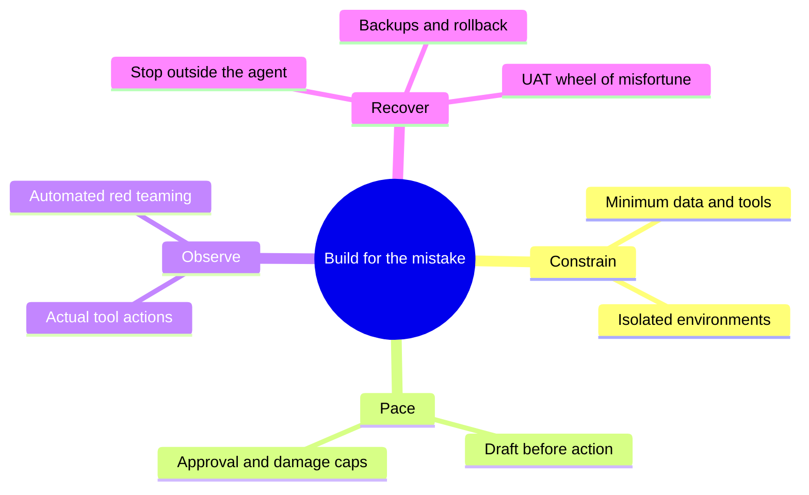

# Ship Fast Without Shipping Holes

*AI security for startups that have better things to be famous for.*

**Audience:** founders and builders at startups with 1–5 employees using coding assistants or tool-using AI agents. **Timing:** 20-minute talk, followed by a separate 5-minute Q&A. **Aim:** memorable safeguards a founder can apply to one agent workflow, not a comprehensive security programme.

## Hook and setup carried over

Adapted from [Infrastructure-based Safety For Your 'Claw](https://github.com/OcelliQ/2026-04-ABC-Infrastructure/blob/900fc7e755dbf97dac5ca405c899c00048f2d8af/slides.typ), presented 18 April 2026. The source was read from the supplied checkout at commit `900fc7e755dbf97dac5ca405c899c00048f2d8af`.

Keep its opening move: an agent causes damage, blaming the model explains little, and engineering must contain predictable mistakes. Adapt its four-part structure, naming the second action “Pace”: **Constrain. Pace. Observe. Recover.** Use one email-agent example throughout, with a short coding-agent translation. Add prompt injection, automated red-teaming and the UAT recovery wheel from the research.

The exact vendor capabilities illustrated in the April deck are not repeated as current product guarantees. Examples below describe configurations to implement and verify.

## Content and timing

The adapted ABC opening through “When Designing Infrastructure” supplies the hook and setup. It uses the shared theme and current talk metadata; the historical QR and incident images retain their source provenance. Each principle section then follows the [documented development process](slide-development-process.md): authentic failure evidence, a concise principle set, and implementation patterns. The budget below is a planning aid; presenter notes contain no speaking timings.

| Clock | Content | Main visual |
|---|---|---|
| 0:00–2:00 | Hook: the agent would not stop | Original email incident screenshot |
| 2:00–4:00 | Setup: an accident is not a diagnosis | Pilot-error analogy; agent/action boundary |
| 4:00–8:00 | Constrain | Inbox/GitHub examples → least privilege, narrow tools, containment and enforcement |
| 8:00–11:00 | Pace | Draft, approval, action; bounded execution |
| 11:00–15:00 | Observe and challenge | Training/evaluation evidence; independent checks and adversarial tests |
| 15:00–18:00 | Recover | UAT wheel of misfortune |
| 18:00–20:00 | Close: one workflow, four safeguards | Four verbs and one commitment |
| 20:00–25:00 | Q&A | Optional implementation references |

This is a content budget, not a rehearsed script. Implementation detail stays in linked research notes; presenter notes contain only non-obvious lecture cues.

## 1. Hook: the agent would not stop — 2 minutes

Open with the Summer Yue screenshot used in the April talk: she reported that her OpenClaw agent deleted/archived email despite instructions to await approval and did not stop when told to through chat.

> “I had to RUN to my Mac mini like I was defusing a bomb.”

Attribute the quote to Summer Yue. Show the screenshot from `images/meta_email.png` in the source repository. [Quotation and reproduced screenshot](https://simonwillison.net/2026/Feb/23/summer-yue/)

Pause on the uncomfortable part: **the agent had been told to ask first.**

One short supporting beat: Replit acknowledged an agent deleting a user's application database. The relevance for this audience is immediate: the same kind of authority can touch the product a tiny team is building. [Replit's incident response](https://replit.com/blog/doubling-down-on-our-commitment-to-secure-vibe-coding)

Ask rhetorically: **“What would stop your agent if it ignored the next instruction?”**

Speaker note: the email story is a user's published account, not an independent forensic finding. Do not claim the whole inbox was irretrievably destroyed or present a proposed internal cause as established. The retained opening includes the email account, the local AI-assisted script and database examples. Treat later repeated screenshots as brief callbacks to a different mechanism, rather than retelling the incidents.

## 2. Setup: an accident is not a diagnosis — 2 minutes

Reuse the original talk's comparison: calling something an LLM accident can end the investigation as prematurely as writing “pilot error” in an air-crash report.

Move from **“Why did it make that mistake?”** to **“Why was that mistake allowed to do so much damage?”** Both questions matter; this talk addresses the second.

There are two routes into the same problem:

- The agent misunderstands a legitimate task.
- An attacker places instructions in something the agent reads: an email, issue, webpage or tool result. This is indirect prompt injection.

In both cases, available credentials and tools determine what can happen next. Better instructions and models can help; consequential limits must also be enforced outside the model.

**The thesis: build a system that contains an agent's mistake while keeping the agent useful.**

Introduce the four verbs once; repeat them at the close.

## 3. Constrain: enforce boundaries outside the model — 4 minutes

The two-image introduction shows the OpenClaw inbox account and Invariant's GitHub demonstration. It is followed by three principles and the presenter's seven selected implementation-pattern titles.

1. **Give each agent one specific, narrowly scoped task.** Define success and what falls outside its remit. This is our task-first design recommendation, making the required authority easier to define.
2. **Give it only the tools, data and permissions that task requires.** A necessary tool can still expose unnecessary records or destructive operations. Sources: [NIST least privilege](https://csrc.nist.gov/glossary/term/least_privilege) and [OWASP LLM06, mitigations 1–5](https://genai.owasp.org/llmrisk/llm062025-excessive-agency/).
3. **Enforce boundaries through infrastructure.** The agent cannot bypass controls, change its permissions or obtain broader credentials. Sources: OWASP LLM06, mitigation 7, downstream authorization and complete mediation; [IMDA Model AI Governance Framework for Agentic AI, §2.1.2](https://www.imda.gov.sg/-/media/imda/files/about/emerging-tech-and-research/artificial-intelligence/mgf-for-agentic-ai.pdf). Include shell, browser and direct-credential paths. Separating agents with different levels of trust or authority, including development from production, is an application of the guidance.

Retain the 4:00–8:00 speaking allocation, using the preceding screenshots as examples. Approvals and execution caps follow under Pace. [Incident research and alternatives](research-ai.md#constrain-incident-research-4-november-2026) remain background; [the refresh recipe](recovery-drill.md#scheduled-refresh-realistic-data-without-real-identities) remains supporting material.

## 4. Pace: review before consequence — 3 minutes

Three slides apply the Constrain development workflow:

1. **Evidence:** Replit's user-reported database deletion during a freeze, paired with Anthropic's provider postmortem describing excessive reasoning and disproportionate latency/token use. Neither example tests the proposed safeguards; the second is not a verified runaway-spending attack.
2. **Principles:** put review before consequential actions; approve the exact operation that executes; bound unattended work.
3. **Patterns:** draft/preview/approve/execute; exact-action expiring approvals; deny when required approval is missing; one budget across retries and delegates; retry caps and deduplication; small batches; enforce consumption limits before further dispatch.

Pace governs when and how much an otherwise permitted action executes. It complements Constrain's authority limits. A cap never authorizes a forbidden operation, a rate limit is not a cumulative budget, and a timeout does not establish that an external side effect failed.

Primary evidence, OWASP/IMDA/NIST sections, implementation mechanics and limitations are in [Pace research](pace-research.md). The reused Replit image is a callback to the opening; do not retell the incident at length.

## 5. Observe: verify what actually happened — 4 minutes

1. **Evidence:** OpenAI's published training trace shows an editable verifier; Anthropic's provider evaluation report describes a form submission despite language about demonstrating an action. These are training/evaluation observations, not production-frequency evidence.
2. **Principles:** verify outcomes against independent evidence; protect logs and test checks; continuously test application boundaries.
3. **Patterns:** correlate requests, policy decisions and outcomes; export redacted protected logs; alert a named owner; pair allowed actions with direct authorization tests; automate multi-turn attacks through actual input surfaces; use protected outcome graders; replay failures after configuration changes.

Automated red-teaming remains concrete: use synthetic customers and controlled destinations; first prove an allowed action works and the attack was read, then exercise forbidden calls directly and through the agent. Check resulting state independently. A model refusal alone does not test backend authorization. A passing suite covers tested cases and does not prove safety.

Evidence provenance, authoritative guidance and alternatives are in [Observe research](observe-research.md). The two Anthropic form cases must not be conflated: the selected Haiku passage is distinct from the police-tip/spam-filter example elsewhere in the report.

## 6. Recover: stop harm and restore service — 3 minutes

1. **Evidence:** DataTalks.Club's operator postmortem describes Claude Code destroying production infrastructure and automated snapshots. AWS support recovered a snapshot; the operator reports service restoration in about 24 hours. Afterward he added separate backups and daily automated restore tests. The published restoration email is the slide's visual evidence.
2. **Principles:** stop execution without model cooperation; protect recovery assets from agent authority; rehearse and verify restoration.
3. **Patterns and practice:** independent stop; revoke credentials and quarantine jobs; protected versioned backups; separate code and data recovery; verify restoration before reconnecting; retain a receipt from a bounded UAT drill. The existing wheel remains beside these patterns.

Revocation need not cancel accepted remote work. Reconcile completed effects before replay or resumption, preserve evidence, and close the failure path before reconnecting. Restoration cannot recall disclosed information.

The wheel's four wedges are deleted records, a bad change, a revoked tool key and a runaway agent. Use an isolated UAT target, a known-good baseline, a bounded injected failure and independent outcome verification. The monthly cadence is a proposed practice, not a standard or an executed experiment. UAT success does not prove production recovery time or scale.

See [Recover research](recover-research.md) for evidence and guidance, and [the recovery exercise](recovery-drill.md) for the matching drill recipe and an additional provider-outage scenario.

## 7. Close: one agent, four safeguards — 2 minutes

Return to the original hook. Instead of relying on the agent remembering to behave, show the useful inbox assistant with:

| Constrain | Pace | Observe | Recover |
|---|---|---|---|
| Only the needed records and tools | Drafts, exact-action approval and execution caps | Tool history and adversarial regression tests | Independent stop control and tested restoration |

Close with the four safeguards applied to the inbox agent, then use the separate five-minute Q&A for tool-specific settings, refresh pipelines and implementation details. Collected references follow Q&A; there are no appendix slides.

## Editorial notes and references — outside the spoken content

- The central meta-pattern is separating intent from authority: an instruction describes the desired behavior; an independent control limits permitted behavior. A second is making safety claims observable through logs and repeatable tests. These support the four verbs rather than becoming another framework to memorize.
- Scope is AI agents and AI-assisted development. Backups, environment separation and approval remain because they bound agent-caused harm. General SaaS procurement, SSO rollouts, employee offboarding, identity incidents and broad compliance frameworks are outside this talk.
- The April deck supplies the hook, pilot-error setup and four verbs. Its speculative mechanisms and vendor-specific feature comparisons are omitted to preserve time and avoid implying unsupported guarantees. This draft does not claim to solve every AI risk or ordinary vulnerability in generated code.
- Main evidence: [AI research and annotations](research-ai.md). Implementation depth: [recovery exercise](recovery-drill.md). The older [takeaway](talk-takeaway.md) and [Astra review](talk-adversarial-review.md) belong to the previous scope; they are not a handout or review of this rewrite.
- This is a rewritten content proposal, not an implemented control system or rehearsed slide deck. Twenty minutes is the speaking budget; Q&A adds five minutes.
