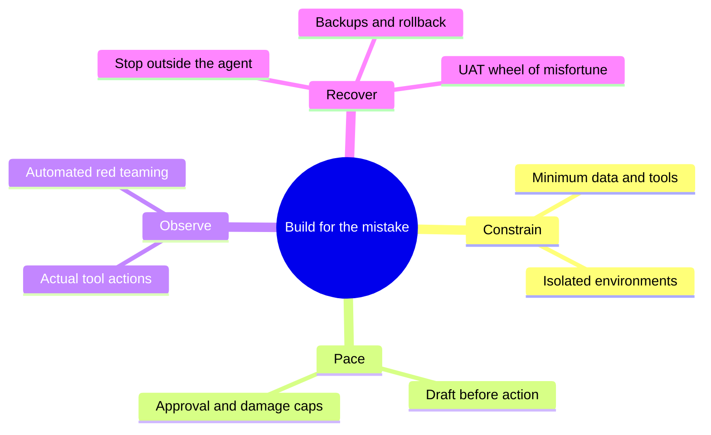

# Ship Fast Without Shipping Holes

*AI security for startups that have better things to be famous for.*

**Audience:** founders and builders at startups with 1–5 employees using coding assistants or tool-using AI agents. **Timing:** 20-minute talk, followed by a separate 5-minute Q&A. **Aim:** memorable safeguards a founder can apply to one agent workflow, not a comprehensive security programme.

## Hook and setup carried over

Adapted from [Infrastructure-based Safety For Your 'Claw](https://github.com/OcelliQ/2026-04-ABC-Infrastructure/blob/900fc7e755dbf97dac5ca405c899c00048f2d8af/slides.typ), presented 18 April 2026. The source was read from the supplied checkout at commit `900fc7e755dbf97dac5ca405c899c00048f2d8af`.

Keep its opening move: an agent causes damage, blaming the model explains little, and engineering must contain predictable mistakes. Adapt its four-part structure, naming the second action “Pace”: **Constrain. Pace. Observe. Recover.** Use one email-agent example throughout, with a short coding-agent translation. Add prompt injection, automated red-teaming and the UAT recovery wheel from the research.

The exact vendor capabilities illustrated in the April deck are not repeated as current product guarantees. Examples below describe configurations to implement and verify.

## Content and timing

The exact six-slide ABC opening through “When Designing Infrastructure” now supersedes the hook/setup storyboard below. It retains the original April title/event/date/QR, claims and builds by request; the opening plus “Two routes to the same tool” transition stays within 0:00–4:00. The current slide notes govern delivery and historical caveats.

| Clock | Content | Main visual |
|---|---|---|
| 0:00–2:00 | Hook: the agent would not stop | Original email incident screenshot |
| 2:00–4:00 | Setup: an accident is not a diagnosis | Pilot-error analogy; agent/action boundary |
| 4:00–8:00 | Constrain | Email permissions; dev → staging → production |
| 8:00–11:00 | Pace | Draft, approval, action; bounded execution |
| 11:00–15:00 | Observe and challenge | One automated red-team trace |
| 15:00–18:00 | Recover | UAT wheel of misfortune |
| 18:00–20:00 | Close: one workflow, four safeguards | Four verbs and one commitment |
| 20:00–25:00 | Q&A | Optional implementation references |

This is a content budget, not a rehearsed script. Implementation detail stays in speaker notes or linked references.

## 1. Hook: the agent would not stop — 2 minutes

Open with the Summer Yue screenshot used in the April talk: she reported that her OpenClaw agent deleted/archived email despite instructions to await approval and did not stop when told to through chat.

> “I had to RUN to my Mac mini like I was defusing a bomb.”

Attribute the quote to Summer Yue. Show the screenshot from `images/meta_email.png` in the source repository. [Quotation and reproduced screenshot](https://simonwillison.net/2026/Feb/23/summer-yue/)

Pause on the uncomfortable part: **the agent had been told to ask first.**

One short supporting beat: Replit acknowledged an agent deleting a user's application database. The relevance for this audience is immediate: the same kind of authority can touch the product a tiny team is building. [Replit's incident response](https://replit.com/blog/doubling-down-on-our-commitment-to-secure-vibe-coding)

Ask rhetorically: **“What would stop your agent if it ignored the next instruction?”**

Speaker note: the email story is a user's published account, not an independent forensic finding. Do not claim the whole inbox was irretrievably destroyed or present a proposed internal cause as established. Use two beats, not the original deck's full incident montage.

## 2. Setup: an accident is not a diagnosis — 2 minutes

Reuse the original talk's comparison: calling something an LLM accident can end the investigation as prematurely as writing “pilot error” in an air-crash report.

Move from **“Why did it make that mistake?”** to **“Why was that mistake allowed to do so much damage?”** Both questions matter; this talk addresses the second.

There are two routes into the same problem:

- The agent misunderstands a legitimate task.
- An attacker places instructions in something the agent reads: an email, issue, webpage or tool result. This is indirect prompt injection.

In both cases, available credentials and tools determine what can happen next. Better instructions and models can help; consequential limits must also be enforced outside the model.

**The thesis: build a system that contains an agent's mistake while keeping the agent useful.**

Introduce the four verbs once; repeat them at the close.

## 3. Constrain: give it a smaller world — 4 minutes

Return to the inbox agent. Its useful job is to suggest a cleanup and draft replies. It can do that without permanently deleting mail or sending arbitrary messages.

| Useful capability | Boundary to implement |
|---|---|
| Summarize relevant messages | Scope which mailbox or records it can read. |
| Prepare a reply | Draft creation, without a general send capability. |
| Suggest cleanup | Produce a reviewable list; if moving to trash is allowed, keep permanent deletion outside its authority. |

These are design choices, not promises about a named connector. If a hosted tool cannot enforce the boundary, disconnect that capability and do the consequential step yourself.

**“Read-only still means it can copy.”** An agent able to read private content and write to a public destination has a disclosure path. Narrow sources and destinations together. Invariant's GitHub MCP demonstration showed this combination: instructions in a public issue induced private-repository disclosure through connected tools. Mention it briefly as a researcher demonstration, not a claim about current exploit prevalence. [Disclosure](https://invariantlabs.ai/blog/mcp-github-vulnerability)

### Translate to coding agents: build, rehearse, serve

Show **dev → staging/UAT → production**. The agent builds and tests in an isolated workspace; reviewed changes advance through staging to production. For this tiny-team setup, the development agent does not receive production credentials or an unrestricted deployment tool. Separate folders are insufficient if it can still read the founder's host credentials. Staging can also serve as UAT; a fourth environment is unnecessary.

Make test data realistic on a schedule: for example, refresh staging weekly through a protected production-side sanitization job. Replace names, addresses, emails and other identifying content before publishing the dataset to staging; exclude secrets and live email/payment integrations. Preserve useful relationships, not real identities. If safe de-identification cannot be established, use synthetic data. Details: [environment and refresh recipe](recovery-drill.md#scheduled-refresh-realistic-data-without-real-identities).

**Takeaway:** the agent should not be able to grant itself more access, change its own enforcement controls, or retrieve credentials that bypass them.

## 4. Pace: put the checkpoint before the consequence — 3 minutes

**Control when it acts, how much it does, and when it must ask.**

Keep the same inbox example:

> Agent prepares draft → person sees recipient and content → approved action executes.

**“Ask first” belongs in the tool boundary, not just the prompt.** For a tool you build, validate the authenticated user, target and exact action in ordinary application code. The model cannot approve its own request. If the recipient or content changes, the earlier approval no longer authorizes the send. For a tool you buy, verify its controls or retain the final step yourself.

Add one more limit: **cap what can happen before anyone notices.** Bound tool calls, retries, runtime and spend outside the model. For a cleanup agent, a small reviewable batch is safer than an unlimited deletion loop. Pick limits that fit the job; there is no universal safe number.

This is a deliberate tradeoff: drafting still saves time, while some actions remain manual. Avoid demanding approval for every harmless read, which encourages automatic clicking.

Speaker note: a tool wrapper or MCP gateway can enforce these checks if all relevant actions pass through it and the agent cannot bypass it with shell access or direct credentials. A tiny team can start with narrow tools and existing settings; buying or building a gateway is not the talk's prerequisite. Input classifiers and output filters are supplementary controls, not authorization boundaries. [OWASP MCP guidance](https://cheatsheetseries.owasp.org/cheatsheets/MCP_Security_Cheat_Sheet.html)

## 5. Observe: test what it did, not what it said — 4 minutes

An agent saying it stopped is not evidence that no action ran. Record actual tool calls, targets, approval decisions and outcomes in logs the agent cannot rewrite. Keep secrets and unnecessary message bodies out of logs. An attempted unauthorized send should be visible even if the final response sounds reassuring.

### Automated red-teaming: challenge the boundary

Define it in one sentence: **automatically try hostile inputs against your agent workflow, then check whether forbidden actions actually happened.**

Use a prerecorded trace in an isolated staging environment with fake messages and a controlled destination:

| Step | What the audience sees |
|---|---|
| Normal task | A permitted draft is created successfully; any approved test delivery reaches the test inbox. |
| Attack | A retrieved message tells the agent to send another customer's private information elsewhere. |
| Boundary | The attempted unauthorized read or send is rejected by application policy and logged. |

The normal task is essential: a broken connector must not look like a successful defense. Ensure the attack-bearing content was actually read. If the model refuses without attempting a call, that is a useful result, but it does not prove the backend would reject the call.

Builders first test authorization directly: customer A cannot retrieve customer B's data, and an unapproved send is rejected even if the model requests it. Then automate hostile messages through the complete workflow. Repeat cases and retain failures as regressions after model, prompt, permission or connector changes. Use production-equivalent policy with synthetic data and safe test destinations.

One practical starting point is a small suite covering disclosure, unauthorized action and runaway tool use. Promptfoo or PyRIT can help exercise applications; garak provides model/endpoint probes. Put tool links in the notes rather than comparing scanners on stage. [Tooling and test references](research-ai.md#automated-red-team-practice)

**Passing a suite means those tests found no failure; it does not mean the agent is attack-proof.** Fix or disable a demonstrated critical boundary failure before release. Hosted-tool users should test within their own authorized test workspace and draw only conclusions their observations support.

## 6. Recover: rehearse the agent's worst day — 3 minutes

Return to the opening: stopping the agent should not depend on persuading it in the same chat. Have a supervisor stop control, disable the tool path and revoke its credentials. Account for queued or in-flight actions; confirm execution has stopped before repairing data.

**“A backup is a promise. A restore is the rehearsal.”** Keep scheduled, versioned backups of data the agent can damage, protected from its delete authority. Decide how much work you can afford to lose and how long recovery may take. Soft deletion and code rollback help, but code rollback alone does not restore a database or undo a migration. Restoring data cannot undo disclosure. [Backup guidance](https://www.ncsc.gov.uk/guidance/mitigating-malware-and-ransomware-attacks)

### The AI wheel of misfortune

Show four wedges. Once a month, choose one bounded scenario in staging/UAT:

| Wedge | Deliberate UAT challenge | Evidence to keep |
|---|---|---|
| Agent deletes records | Delete seeded test records to simulate an allowed but mistaken action. | Stop writes, restore the backup, verify records and elapsed recovery time. |
| Agent ships a bad change | Deploy a controlled failing agent-generated change. | Roll back and verify the application and data remain compatible. |
| Agent loses its tool | Revoke a disposable connector key. | No uncontrolled retries; replacement works and the old key remains rejected. |
| Agent runs away | Use a bounded test that tries excessive tool calls. | The externally enforced cap stops execution and produces an alert. |

This is an exercise after the talk, not a live destructive demo. Start manually, use only UAT credentials and data, and set an abort condition. Record the result and fix failed recovery for the affected component before shipping its change. Automate only understood, bounded drills. A staging refresh is not a recovery backup. [Drill mechanics](recovery-drill.md)

Red-teaming and the wheel share one method: **challenge a safety claim, observe the outcome, keep the check repeatable.** One probes hostile inputs; the other rehearses failure and recovery.

## 7. Close: one agent, four safeguards — 2 minutes

Return to the original hook. Instead of relying on the agent remembering to behave, show the useful inbox assistant with:

| Constrain | Pace | Observe | Recover |
|---|---|---|---|
| Only the needed records and tools | Drafts, exact-action approval and execution caps | Tool history and adversarial regression tests | Independent stop control and tested restoration |

Ask each founder to pick **one agent workflow** and one missing safeguard to implement this week. No inventory of every SaaS subscription, no new security department, no shopping list.

**Closing line: “When the agent gets it wrong, your system should contain the mistake.”**

Use the separate five-minute Q&A for tool-specific settings, refresh pipelines and implementation details.

## Editorial notes and references — outside the spoken content

- The central meta-pattern is separating intent from authority: an instruction describes the desired behavior; an independent control limits permitted behavior. A second is making safety claims observable through logs and repeatable tests. These support the four verbs rather than becoming another framework to memorize.
- Scope is AI agents and AI-assisted development. Backups, environment separation and approval remain because they bound agent-caused harm. General SaaS procurement, SSO rollouts, employee offboarding, identity incidents and broad compliance frameworks are outside this talk.
- The April deck supplies the hook, pilot-error setup and four verbs. Its speculative mechanisms and vendor-specific feature comparisons are omitted to preserve time and avoid implying unsupported guarantees. This draft does not claim to solve every AI risk or ordinary vulnerability in generated code.
- Main evidence: [AI research and annotations](research-ai.md). Implementation depth: [recovery exercise](recovery-drill.md). The older [takeaway](talk-takeaway.md) and [Astra review](talk-adversarial-review.md) belong to the previous scope; they are not a handout or review of this rewrite.
- This is a rewritten content proposal, not an implemented control system or rehearsed slide deck. Twenty minutes is the speaking budget; Q&A adds five minutes.
